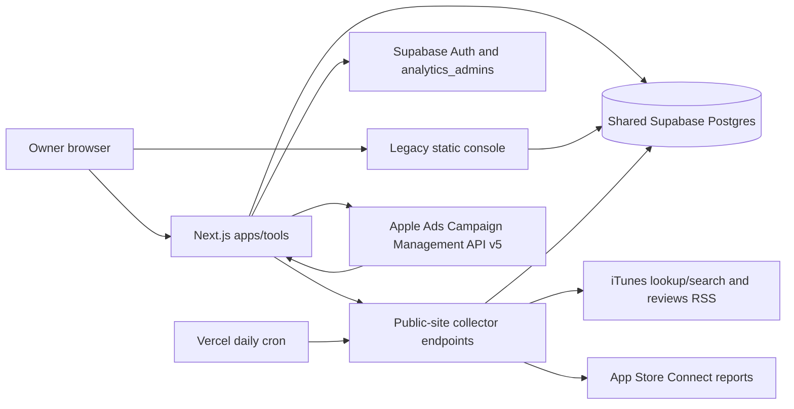

# 01 — Codebase forensic audit

Audit date: 2026-10-14 (Europe/Berlin). Repository: `/Users/otastemelis/Documents/kopa-studio`. Baseline: `189d42b6` (`docs: complete trust and data correctness milestone`), 84 commits, 315 tracked files. This is an audit, not an implementation or production certification.

**Decision:** preserve the modern application shell and historical records; selectively replace the collection, observation identity, and metric aggregation layers. The strongest evidence of unreliability concerns what the numbers mean and how they are ingested. A framework replacement would not correct those defects.

## Evidence boundaries

- **Verified:** local source, migration definitions, lockfile, git history, offline tests, build, localhost startup, npm advisory response, and current public documentation.
- **Historical evidence:** existing July handovers describe earlier live checks. Those checks were not repeated against authenticated accounts and are not current operational evidence.
- **Unknown:** deployed commit, live database schema and row counts, actual collection coverage, enabled cron execution, provider entitlements, available report history, current key roles and expiry, backup/restore quality, and authenticated rendered workflows.
- No `.env` was loaded, no production database was queried or changed, no provider credits were spent, no campaign or metadata mutation was made. Checks used an isolated copy of tracked source and existing dependencies. No packages were installed.
- Four unrelated untracked website/screenshot files existed before this audit and were preserved.

## Architecture actually present

| Layer | Actual implementation | Implication |
|---|---|---|
| Public site | Static HTML/CSS/JS, privacy/support pages, games; root `package.json` starts Python HTTP server | Root start command does not run the tools app or serverless APIs |
| Legacy ASO UI | `src/aso-console.js`, 2,208 lines, direct authenticated PostgREST access | Second UI and write path remain; not merely dead code |
| Current UI/server | `apps/tools`, Next App Router, React, TypeScript, Zod, Tailwind | Suitable foundation for an internal tool; keep |
| Persistence | Shared Supabase Postgres, REST/SDK, Auth; `aso_*` and `apple_ads_*` tables | No separate backend needed; shared product events enlarge credential blast radius |
| Public/ASC ingestion | Root `api/aso/collect.js`, JavaScript helpers | New UI still depends on old public deployment |
| Ads ingestion | Next route handlers, repositories, services, v5 OAuth adapter | Independent import path; neither full daily automation nor Platform API support |
| Scheduling | Root `vercel.json`: `30 17 * * *`, `/api/aso/collect`, 300-second limit | 17:30 UTC schedule; actual execution unverified. Tools config has no cron |
| Jobs | `aso_jobs`, `aso_sync_runs`, `apple_ads_sync_runs`, collection lease | Durable records exist; retry/recovery semantics incomplete |
| AI | Deterministic recommendation rules and ZIP review pack | No model integration, general analytics API, or MCP server found |

Source entry points: [README.md:1](/Users/otastemelis/Documents/kopa-studio/README.md:1), [vercel.json:1](/Users/otastemelis/Documents/kopa-studio/vercel.json:1), [apps/tools/vercel.json:1](/Users/otastemelis/Documents/kopa-studio/apps/tools/vercel.json:1), [apps/tools/src/app/api/jobs/route.ts:6](/Users/otastemelis/Documents/kopa-studio/apps/tools/src/app/api/jobs/route.ts:6), [api/aso/collect.js:34](/Users/otastemelis/Documents/kopa-studio/api/aso/collect.js:34), [apps/tools/src/lib/apple-ads/apple-ads-provider.ts:68](/Users/otastemelis/Documents/kopa-studio/apps/tools/src/lib/apple-ads/apple-ads-provider.ts:68).

### Framework and dependency baseline

Manifest ranges differ from resolved versions. `apps/tools/package-lock.json` resolves Next **15.5.20**, React/React DOM **19.2.7**, Supabase JS **2.110.7**, Supabase SSR **0.7.0**, Zod **3.25.76**, TypeScript **5.9.3**, Vitest **3.2.7**, ESLint **9.39.5**, Tailwind **4.3.3**. The installed Next version is also confirmed by the build. Source: [apps/tools/package.json:13](/Users/otastemelis/Documents/kopa-studio/apps/tools/package.json:13); resolved inventory is in `evidence/dependency-summary.md`.

After explicit user authorization, `npm audit --json --ignore-scripts` reported **15 affected dependency nodes: 3 critical, 11 high, 1 moderate**. This includes transitive and development dependencies and is not a count of independently exploitable production vulnerabilities. Next is affected by multiple advisories; Vitest/tinypool affect development/test execution. Treat dependency remediation as a release gate. Do not run `npm audit fix --force`: the suggested graph includes a major Vitest change and an undesirable eslint-config-next downgrade. Assess each runtime exposure, upgrade supported compatible versions, regenerate the lockfile, and rerun relevant checks. See the exact advisory URLs in the evidence summary.

## Feature inventory

“Implemented” below means code exists and is connected to a UI or handler. It does not establish successful current production use.

| Feature | Status and limitation |
|---|---|
| Owner authentication | `requireUser` checks a Supabase user and `analytics_admins`; fail-closed decision helper has tests. PageShell also checks access. No anonymous data exposure was demonstrated |
| App registry | Lookup/add/upsert and app pages exist. Numeric App Store ID and bundle ID are separate; no verified consolidated identity with product-event app IDs |
| Keyword tracking | Bulk create, edit, pause, remove, filters, current ranks and paid coverage exist. Public-search position is not validated organic rank; mutation/deletion risks below |
| Rank history | 35-day table retained during UI migration; capped queries and weak method provenance |
| Competitors | App relationships, public snapshots, tracked-keyword comparisons. Does not discover competitors' full keyword universe |
| Metadata/localization | Change snapshots, locale safeguards, manual readiness flags. Public lookup has no subtitle or keyword field; multi-market metadata collection incomplete |
| ASC | Mapping/test/provision actions, latest Summary Sales and Discovery report sync. No complete downloads/commerce/subscription pipeline |
| Apple Ads | OAuth/ACL, mappings, campaign/ad-group/keyword/ad-group-negative imports, campaign metrics and search terms. No complete keyword/ad-group/ad daily performance importer |
| Recommendations | ASO rules plus newer Ads evidence assessment, snooze/dismiss/complete, cross-source identity and evidence UI. Rules inherit ingestion defects and product-specific assumptions |
| Experiments | Hypothesis, status, result/conclusion/next action; pre/post rules. Does not implement a controlled experiment engine |
| Product analytics | Reads shared events/catalog, presents event funnels. Client purchase events are not validated proceeds; event-count ratios are not user conversion funnels |
| Export | ZIP review pack with source rows, manifest and deterministic summaries. Useful starting point; truncation/date-scope issues below |
| Operations | Jobs, collection history, source-status and quality screens. No proven end-to-end daily source completeness or out-of-band alerting |
| AI/automation | Readable export and pure rules; no actual LLM analyst, MCP, approval execution engine, or external campaign writers |

UI anchors: [apps/tools/src/components/sidebar.tsx:7](/Users/otastemelis/Documents/kopa-studio/apps/tools/src/components/sidebar.tsx:7), [apps/tools/src/app/page.tsx:12](/Users/otastemelis/Documents/kopa-studio/apps/tools/src/app/page.tsx:12), [apps/tools/src/app/keywords/page.tsx:9](/Users/otastemelis/Documents/kopa-studio/apps/tools/src/app/keywords/page.tsx:9), [apps/tools/src/app/analytics/page.tsx:39](/Users/otastemelis/Documents/kopa-studio/apps/tools/src/app/analytics/page.tsx:39), [apps/tools/src/services/review-pack-service.ts:10](/Users/otastemelis/Documents/kopa-studio/apps/tools/src/services/review-pack-service.ts:10).

## Findings, ordered by decision risk

Priority P1 means resolve before relying on the affected metric/workflow; P2 means bounded reliability or maintenance work. These are source/contract findings, not assertions about the number of currently corrupted live rows.

| ID | Priority | Finding and evidence | Consequence / disposition |
|---|---|---|---|
| F01 | P1 | `searchApps` numbers iTunes Search results; collector stores that as `rank`. [api/aso/_lib/providers.js:94](/Users/otastemelis/Documents/kopa-studio/api/aso/_lib/providers.js:94), [api/aso/collect.js:287](/Users/otastemelis/Documents/kopa-studio/api/aso/collect.js:287) | Relabel legacy series as `itunes_search_position`; do not call it verified organic rank |
| F02 | P1 | Discovery reads four recent instances, then adds rows with the same app/date/country/event/page/source across all of them. [api/aso/_lib/appstore-analytics.js:196](/Users/otastemelis/Documents/kopa-studio/api/aso/_lib/appstore-analytics.js:196), [api/aso/_lib/appstore-analytics.js:239](/Users/otastemelis/Documents/kopa-studio/api/aso/_lib/appstore-analytics.js:239) | Apple's newer-instance replacement rule is violated. Reconstruct affected partitions from retained source evidence, not by dividing totals |
| F03 | P1 | Sales `Developer Proceeds` is parsed per row then simply summed; units are not multiplied. Product type is parsed but never used to classify downloads. IAP rows generally have a different Apple ID and are unmatched. [api/aso/_lib/appstore-sales.js:78](/Users/otastemelis/Documents/kopa-studio/api/aso/_lib/appstore-sales.js:78), [api/aso/_lib/appstore-sales.js:138](/Users/otastemelis/Documents/kopa-studio/api/aso/_lib/appstore-sales.js:138) | Proceeds and download labels can be wrong; app revenue incomplete. Replace with typed transaction-class measures and parent-app mapping |
| F04 | P1 | Search-term request spans seven days, asks range totals without daily granularity, and parser assigns an undated total to `endDate`. [apps/tools/src/lib/apple-ads/apple-ads-provider.ts:109](/Users/otastemelis/Documents/kopa-studio/apps/tools/src/lib/apple-ads/apple-ads-provider.ts:109), [apps/tools/src/lib/apple-ads/reporting.ts:11](/Users/otastemelis/Documents/kopa-studio/apps/tools/src/lib/apple-ads/reporting.ts:11), [apps/tools/src/app/api/apple-ads/reports/campaigns/route.ts:23](/Users/otastemelis/Documents/kopa-studio/apps/tools/src/app/api/apple-ads/reports/campaigns/route.ts:23) | A rolling period total becomes a “daily” observation. Repeated runs can overcount. Keep range facts separate; fetch real daily data |
| F05 | P1 | Campaign request lacks country grouping and uses UTC; search terms use ORTZ. Assessment copies `country=all` campaign totals into every configured storefront. [apps/tools/src/lib/apple-ads/apple-ads-provider.ts:108](/Users/otastemelis/Documents/kopa-studio/apps/tools/src/lib/apple-ads/apple-ads-provider.ts:108), [apps/tools/src/services/apple-ads-evidence-assessment-service.ts:102](/Users/otastemelis/Documents/kopa-studio/apps/tools/src/services/apple-ads-evidence-assessment-service.ts:102) | Multi-country recommendations can repeat the same spend as country evidence; incompatible dates. Reject unallocated totals at market level |
| F06 | P1 | `installs` falls back to `totalInstalls`; CPA/CVR use that unlabeled number. Reporting summary sums spend without grouping currency. [apps/tools/src/lib/apple-ads/reporting.ts:1](/Users/otastemelis/Documents/kopa-studio/apps/tools/src/lib/apple-ads/reporting.ts:1), [apps/tools/src/repositories/apple-ads-reporting-repository.ts:5](/Users/otastemelis/Documents/kopa-studio/apps/tools/src/repositories/apple-ads-reporting-repository.ts:5) | Attribution definitions and money can be mixed. Preserve tap/view/total metrics and currency as required dimensions |
| F07 | P1 | A malformed HTTP-200 search body becomes `[]`; collector writes `collection_status=ok`, `found=false`. Failures produce run errors, not individual failed observations. [api/aso/_lib/providers.js:96](/Users/otastemelis/Documents/kopa-studio/api/aso/_lib/providers.js:96), [api/aso/collect.js:318](/Users/otastemelis/Documents/kopa-studio/api/aso/collect.js:318), [api/aso/collect.js:370](/Users/otastemelis/Documents/kopa-studio/api/aso/collect.js:370) | Parser failure can masquerade as absent rank. Contract validation and explicit per-attempt outcomes required |
| F08 | P1 | Editing an assignment mutates shared `aso_keywords` term/country/language. Removing the last assignment deletes the keyword, whose rank/search children cascade. [apps/tools/src/app/api/keywords/[linkId]/route.ts:11](/Users/otastemelis/Documents/kopa-studio/apps/tools/src/app/api/keywords/[linkId]/route.ts:11), [supabase/migrations/20260719000000_aso_intelligence.sql:119](/Users/otastemelis/Documents/kopa-studio/supabase/migrations/20260719000000_aso_intelligence.sql:119) | Existing history can be relabeled or destroyed. Immutable query identity, new series on edit, archive tracking instead of cascading deletion |
| F09 | P1 | `apple_ads_daily_metrics` and search-term uniqueness include nullable dimensions. Lookup-then-insert is not atomic. [supabase/migrations/20260721060000_apple_ads_reporting.sql:1](/Users/otastemelis/Documents/kopa-studio/supabase/migrations/20260721060000_apple_ads_reporting.sql:1), [supabase/migrations/20260721100000_apple_ads_search_terms.sql:1](/Users/otastemelis/Documents/kopa-studio/supabase/migrations/20260721100000_apple_ads_search_terms.sql:1), [apps/tools/src/services/apple-ads-report-sync-service.ts:4](/Users/otastemelis/Documents/kopa-studio/apps/tools/src/services/apple-ads-report-sync-service.ts:4) | Concurrent imports may create duplicates. Use normalized non-null grain/NULLS NOT DISTINCT where supported, transactional upserts and leases |
| F10 | P2 | Collector handles at most 50 keywords, including paused links; metadata, reviews, sales, analytics and insight work share the 300-second invocation. [api/aso/collect.js:267](/Users/otastemelis/Documents/kopa-studio/api/aso/collect.js:267), [api/aso/collect.js:376](/Users/otastemelis/Documents/kopa-studio/api/aso/collect.js:376) | Daily completeness not guaranteed; 50-keyword budget ignores other requests/retries. Chunk per source/scope with deadline and cursors |
| F11 | P2 | Job scope accepted and stored, but `runCollection('cron')` receives none. Claimed job completes even for partial collection; no running-job timeout recovery. Lock and run creation precede main try/finally. [api/aso/collect.js:47](/Users/otastemelis/Documents/kopa-studio/api/aso/collect.js:47), [api/aso/collect.js:73](/Users/otastemelis/Documents/kopa-studio/api/aso/collect.js:73), [apps/tools/src/app/api/jobs/route.ts:31](/Users/otastemelis/Documents/kopa-studio/apps/tools/src/app/api/jobs/route.ts:31) | UI scope does not constrain collection; crashes can strand job status. Implement leased, scoped, recoverable tasks |
| F12 | P1 | Bounded queries are used as if complete datasets: rankings 1,000; reporting 180; term list 500; ASC rows 5,000; REST helper has no pagination. [apps/tools/src/repositories/ranking-repository.ts:14](/Users/otastemelis/Documents/kopa-studio/apps/tools/src/repositories/ranking-repository.ts:14), [apps/tools/src/repositories/apple-ads-reporting-repository.ts:5](/Users/otastemelis/Documents/kopa-studio/apps/tools/src/repositories/apple-ads-reporting-repository.ts:5), [api/aso/_lib/supabase.js:45](/Users/otastemelis/Documents/kopa-studio/api/aso/_lib/supabase.js:45) | Totals/coverage can silently truncate. Distinguish page display limits from complete server aggregates and ingestion cursors |
| F13 | P2 | Discovery trends split observed rows at midpoint; metric row count is used as days-with-data in legacy pre/post logic. [apps/tools/src/lib/metrics.ts:78](/Users/otastemelis/Documents/kopa-studio/apps/tools/src/lib/metrics.ts:78), [api/aso/_lib/calc.js:76](/Users/otastemelis/Documents/kopa-studio/api/aso/_lib/calc.js:76), [api/aso/_lib/calc.js:133](/Users/otastemelis/Documents/kopa-studio/api/aso/_lib/calc.js:133) | Sparse days or multiple sources/countries can satisfy a day threshold without enough dates. Compare explicit calendar partitions and distinct complete dates |
| F14 | P2 | Review pack timestamp filters end at a date-only upper bound, reads unpaged tables, and labels current metadata with the requested historical window. [apps/tools/src/services/review-pack-service.ts:12](/Users/otastemelis/Documents/kopa-studio/apps/tools/src/services/review-pack-service.ts:12), [apps/tools/src/services/review-pack-service.ts:16](/Users/otastemelis/Documents/kopa-studio/apps/tools/src/services/review-pack-service.ts:16), [apps/tools/src/services/review-pack-service.ts:66](/Users/otastemelis/Documents/kopa-studio/apps/tools/src/services/review-pack-service.ts:66) | End-date events may be omitted; export may look more historical/complete than it is. Use half-open timestamps, explicit current/as-of states and completeness manifest |
| F15 | P2 | `uk-evidence-to-action-v1` contains personality/relationship product intent phrases for all apps. [apps/tools/src/lib/apple-ads/evidence-assessment.ts:1](/Users/otastemelis/Documents/kopa-studio/apps/tools/src/lib/apple-ads/evidence-assessment.ts:1), [apps/tools/src/lib/apple-ads/evidence-assessment.ts:139](/Users/otastemelis/Documents/kopa-studio/apps/tools/src/lib/apple-ads/evidence-assessment.ts:139) | Not a general multi-app analyst; POIS cannot inherit this taxonomy. Move reviewed product intent into versioned per-app configuration |
| F16 | P2 | Client `purchase_success`, `ad_revenue_paid`, event counts and first-open labels are shown as product funnel/revenue signals. [apps/tools/src/app/analytics/page.tsx:49](/Users/otastemelis/Documents/kopa-studio/apps/tools/src/app/analytics/page.tsx:49) | Keep as instrumentation signals, separately reconcile verified transactions; do not use as subscription value or unique-install truth |
| F17 | P1 release | Lockfile advisory findings and missing ESLint flat config; no tracked CI workflow found. [apps/tools/package.json:9](/Users/otastemelis/Documents/kopa-studio/apps/tools/package.json:9) | Add a reproducible check pipeline; patch dependencies without a major product rewrite |
| F18 | P2 | App/competitor metadata fetched only for primary market; competitors lack country in snapshot identity. [api/aso/collect.js:100](/Users/otastemelis/Documents/kopa-studio/api/aso/collect.js:100), [api/aso/collect.js:188](/Users/otastemelis/Documents/kopa-studio/api/aso/collect.js:188), [supabase/migrations/20260719000000_aso_intelligence.sql:96](/Users/otastemelis/Documents/kopa-studio/supabase/migrations/20260719000000_aso_intelligence.sql:96) | Cannot substantiate multi-country metadata change monitoring. Preserve observed market/locale per snapshot |

F02 is supported by Apple's [Data completeness and corrections](https://developer.apple.com/documentation/analytics-reports/data-completeness-corrections). F03 is supported by Apple's [Summary Sales report field definitions](https://developer.apple.com/help/app-store-connect/reference/reporting/summary-sales-report). See document 02 for the complete public-data journey and document 04 for source contracts.

### Security and credential architecture

The owner gate is substantive: [apps/tools/src/lib/auth.ts:8](/Users/otastemelis/Documents/kopa-studio/apps/tools/src/lib/auth.ts:8) validates the session and membership using a server-only service-role client; [apps/tools/src/lib/access-control.ts:9](/Users/otastemelis/Documents/kopa-studio/apps/tools/src/lib/access-control.ts:9) denies missing/failed membership. Most pages explicitly authenticate; PageShell also checks. Product Analytics performs reads before its PageShell is rendered, so move authorization ahead of all service-role reads even though this audit did not demonstrate data disclosure. Middleware refreshes sessions and is not the access boundary.

Supabase RLS and explicit grants are defined in migrations and separate SQL policy files. Initial migrations deny direct client access; `supabase/aso-security.sql` later grants approved admins browser CRUD on human-input tables and read access to collected tables. This is intentional dual access, not tenant isolation. Applying only migrations does not reproduce all policy setup. Shared `events`, `analytics_events`, and `event_catalog` dependencies are not fully created by the ASO migration chain. Live policy state and a clean database restore remain unverified.

ASC keys are read from server environment, ES256 JWTs last five minutes, and setup Admin credentials are separate from routine read credentials: [api/aso/_lib/appstore-connect.js:33](/Users/otastemelis/Documents/kopa-studio/api/aso/_lib/appstore-connect.js:33). Ads client secret/token cache is server-side: [apps/tools/src/lib/apple-ads/credential-store.ts:12](/Users/otastemelis/Documents/kopa-studio/apps/tools/src/lib/apple-ads/credential-store.ts:12). No rotation/expiry monitoring is implemented. Never embed the attribution ingestion bearer in an iOS binary: [apps/tools/src/app/api/apple-ads/attribution/route.ts:3](/Users/otastemelis/Documents/kopa-studio/apps/tools/src/app/api/apple-ads/attribution/route.ts:3) is suitable only behind a trusted server intake, with app/account validation and replay protection added later.

No secret values were printed or copied into deliverables. Environment presence is not evidence that credentials are valid. This was not an exhaustive historical secret scan or penetration test. Root CSP/security headers do not automatically apply to the separate Tools deployment; browser-security verification belongs in its release checklist.

### Jobs, observability and failure behavior

Useful: collection database lease, `SKIP LOCKED` claim, item counters, errors, parser version and rejected-row diagnostics, saved raw ASC/Ads payloads, source-status recency logic, and recommendation fingerprints.

Missing: task attempt/lease expiry for jobs, heartbeat/reaper, per-source deadline, pervasive request timeouts, complete pagination, transactional fact replacement, circuit breaking, source-specific freshness coverage, persistent throttling across instances, and a proven alert delivery channel. `warnings` for sales/reviews/analytics do not make overall collection status partial when public items succeed (`collect.js:421`). A green global header is therefore weaker than “all sources fresh.”

## What to keep, simplify and retire later

| Keep after validation | Simplify or replace | Retire only after parity |
|---|---|---|
| Supabase/Postgres, app UUIDs and external IDs, raw history, snapshots, decisions and experiments | Shared query identity mutations and destructive deletes | Legacy console/data writers |
| Next shell, auth boundary, forms, tables, context bar, data-quality components | Generic pass-through services with two lines and no domain behavior | Separate public-site dependency for internal ingestion |
| Tested locale/evidence quality, recommendation identity, dedupe/reconciliation concepts | Both calculation mirrors and overlapping Ads recommendation engines | Legacy `/rankings` migration table after useful history exists in Keywords |
| Discovery parser header validation/diagnostics, metadata diff/checksum | Aggregation and report-instance semantics, v5 transport/parser | Historical roadmap stacks as active product specifications |
| ZIP export pattern and recorded evidence | “Low volume model” and guardrails as claims of operational readiness | Unused generation path `generateSearchTermRecommendations`, after preserving its useful tests/logic |

`evaluateGuardrails` has no production caller found; it is not a functioning safety system. `generateSearchTermRecommendations` is exported but no active caller was found; report import uses the newer evidence assessment. One-line wrappers are maintenance noise, not a reason to abandon Next or TypeScript. Public websites/games have separate value and are outside the growth-platform replacement boundary.

## Verification results

| Check | Result | What it establishes |
|---|---|---|
| `npm test` in Tools | **30 files / 129 tests passed** | Existing pure and mocked repository behavior |
| `node --test api/aso/_lib/*.test.mjs` | **43 passed** | Collector helper/parser/insight contract checks |
| `npm run typecheck` | **Passed** | Static type compatibility |
| `npm run build` | **Passed** | Production compilation and route generation |
| `npm run lint` | **Failed** | ESLint 9 cannot find `eslint.config.*` |
| Isolated production startup | **Passed** | Next listens on localhost |
| Anonymous secret endpoints | **401** for Ads sync and attribution | Fail-closed secret check without configured secrets |
| `/`, `/login` without environment | HTTP 200 streamed loading shell; server Zod configuration errors | **Not a working login/dashboard acceptance** |
| Database/migrations | Source inspection only | No clean migration run, live reconciliation or backup restore verified |
| Advisory check | 15 affected dependency nodes | Registry match, not exploitability proof |
| Authenticated UI / real ingestion | **Not verified** | Requires a safe read-only account/data-validation session |

The 172 passing tests are useful but omit several full transport-to-storage contracts above. Synthetic offline probes reproduced overlapping Discovery instances storing 22 instead of the newest 12, per-unit Sales proceeds storing 1.50 instead of 4.50 for three units, malformed search becoming empty, undated range totals receiving a day, and currency-blind summation; they are explicitly test inputs, not app performance data. No application code was changed to make checks pass.

## Evolution and product implications

Git shows a rapid July expansion: initial baseline → data-integrity repair → ASC sales/analytics/reviews/experiments → separate Next migration → Apple Ads workspace → evidence/recommendation/locale correctness. Later commits address real trust problems, including source recency, exact locale, and recommendation identity. Preserve those improvements. The history does not justify assuming all earlier functional claims remain true.

The current home page emphasizes record counts and open recommendations rather than comparable per-app acquisition and value. This supports the hypothesis of weak practical workflow, but owner usage was not measured. Validate the replacement against a two-week real decision diary. Stop adding features if a concise report in existing vendor tools solves the problem at lower total effort.
