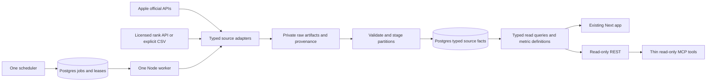

# 06 — Architecture decision

Status: **Recommended, pending owner acceptance for implementation.** No code rewrite, schema change or migration was performed. Evidence date: 2026-10-14.

## Decision

**Option B: selective rebuild, retaining Next.js + TypeScript + Supabase/Postgres, with licensed rank data and official Apple imports.** Rebuild the ingestion contracts and source-aware query layer in small vertical slices. Preserve app IDs, raw/historical records, experiments and useful evidence helpers. Consolidate into one internal application and one durable ingestion worker after parity. Do not rebuild the unrelated public website or games.

Option A can produce a short safety patch and honest read-only view quickly, but cannot avoid identity/history and partition semantics changes. Option C repeats auth/forms/hosting work and still needs the same provider contracts. Neither a new frontend framework nor a microservice fleet solves the observed defects.

## Options scored

Scores are engineering judgment: 1 poor, 5 strong, **higher is always better**. Equal weights expose tradeoffs without implying measured precision. All options assume the same small product scope; licensed data can improve each, but B incorporates it as the recommended hybrid.

| Criterion | A Repair/simplify | B Selective rebuild + data provider | C Clean rebuild |
|---|---:|---:|---:|
| Low engineering complexity | 4 | 4 | 2 |
| Data reliability after completion | 3 | 5 | 5 |
| Time to first useful slice | 5 | 4 | 2 |
| Low maintenance burden | 2 | 4 | 4 |
| Low monthly operating cost | 4 | 3 | 3 |
| Multi-app/storefront growth | 2 | 5 | 5 |
| AI query readiness | 2 | 5 | 5 |
| Security clarity | 3 | 4 | 4 |
| Low migration risk | 4 | 4 | 2 |
| Product simplicity | 2 | 5 | 4 |
| **Total / 50** | **31** | **43** | **36** |

B's lower cost score reflects licensed observation cost, not an assumed large infrastructure bill. A's “cheap scraper” is not a valid way to obtain the same measurement. A clean rebuild could be justified if a bounded prototype shows the existing UI blocks simplification, but current evidence does not support that expense.

**Buy-only comparator:** use Apple + one vendor UI, exports and a weekly decision note. This may be fastest and cheapest when owner needs are satisfied. Try it during the source pilot. Build custom integration only where it removes recurring joining or decision effort. Buying a vendor interface does not automatically buy API or retention rights.

## Concrete target

**Deployment recommendation:** keep the existing Next/Vercel Tools app, existing Supabase Auth/database and private object storage where available. Add one small long-running Node worker on a single managed host with a scheduler, polling a Postgres queue. No Redis, Kafka or workflow platform is required. A managed runner is preferable to a personal Mac for unattended collection. Choose the host only after confirming existing plan/runtime/budget; no deployment action is authorized by this recommendation.

An alternative is bounded scheduled functions over the same task table if measured work consistently fits their limits. The present 300-second combined collector does not demonstrate that. Start with one job runner process, concurrency one per constrained provider/account, and scale only after observed backlog needs it. Keep scheduling responsibility in one place.

Source and worker modules live in the same repository/package family as the web app and share validators/types/metric functions. Avoid a generic plugin/ETL framework. Keep source-version differences inside separate adapters. The legacy root collector remains during shadow validation, with only one authoritative writer for each active source partition.

## Storage and identities

Use additive tables/views where the existing grain is unsafe. Proposed names are logical design, not a migration script.

| Domain | Minimal design / constraints |
|---|---|
| Apps/external identities | Keep existing app UUID; unique source-account/external-ID mapping for App Store, bundle, ASC, Ads promoted object and product telemetry. Validate mismatches rather than joining on name |
| Markets/queries | Country, device, requested locale and observed locale separate. Immutable normalized term/country/requested-locale/device/provider-method query key; per-app tracking membership with active/archive dates |
| Collection attempts | Expected query/partition, provider account, window, status, attempt number, lease expiry, started/finished, cursor, watermark and error category. Unique active idempotency scope |
| Raw artifacts | Private object plus SHA-256, request shape with secrets removed, response status, source report/instance/segment/processing date, parser version, observed/fetched time and retention class |
| Organic observations | Append-only sample ID/query/app, observed timestamp, explicit method/provider/version, rank or null, depth, quality state, source artifact. Daily display projection selects a documented representative sample |
| ASC partitions | Typed report-specific tables keyed by full retained dimensions plus selected source revision. Unique partition manifest by app/report/granularity/event date, current instance processing date, full segment set and checksum |
| Ads facts | Separate campaign/group/keyword/ad/search-term grain or explicit typed grain. Account/external entity IDs, period bounds, source timezone, country, currency, tap/view/total measures; no range facts disguised as daily |
| Changes/experiments | Preserve existing records; add design type, metric definition, baseline/evaluation snapshot, primary criterion, source scope and confounders |
| Recommendations | Existing stable identities + evidence fingerprint, generated/evaluated windows, rule/product-taxonomy versions, stale/withdrawn state and owner response |
| Future operations | Separate proposal, approval and execution audit records; not part of the V1 executor |

Prevent delete cascade from removing research evidence. Archive tracked entities; deletion is an explicit separately authorized retention operation. A changed query starts a new series. Avoid a giant generic `metrics(name,value,json_dimensions)` table that weakens grain/currency constraints. Source-specific typed facts and small read views are enough.

Use non-null canonical dimension keys or supported `UNIQUE NULLS NOT DISTINCT` constraints for facts whose optional IDs participate in identity. Verify live Postgres version before choosing syntax. All imports use atomic DB upsert/replacement, never check-then-insert races. Decimal amounts and ISO currency are mandatory for money. No cross-currency grand total without an explicit FX rate/source/date.

## Import transaction and recovery contract

1. Enqueue a task with an immutable source/account/app/report/window key. DB claim with SKIP LOCKED, lease expiry and heartbeat. Reaper returns expired attempts to retry with bounded backoff.
2. Download all pages/segments to private staging. Validate response shape, counts, IDs, date ranges, currency and checksums. Record semantic errors even with HTTP 200.
3. Select the correct source revision. For ASC, all segments of the newest applicable instance for each date; never sum overlapping processing dates. For Ads, reimport revised period facts with explicit native attribution metrics.
4. In one database transaction, publish the complete partition and manifest/watermark. If any page/segment fails, keep the last complete partition and attach a failed/partial attempt. Do not publish partial counts as a complete day.
5. Retry is safe because source revision/checksum/natural keys deduplicate. If the upstream write of a future operation is uncertain, reconciliation precedes any retry.
6. After completion, refresh small SQL summaries and deterministic opportunities. A source-health alert is generated from expected-vs-complete partitions and latest outcomes, not the global last success.

Provider retries use explicit deadlines and documented rate headers, bounded exponential backoff/jitter, per-account concurrency and credit budgets. Validate full pagination before marking complete. Raw artifacts permit parser replay without new paid requests. Store invalid records quarantined with reasons rather than silently coercing malformed numbers to zero.

For zero-row responses, distinguish valid zero, suppressed/no eligible rows, report pending, missing permission, unsupported scope and schema failure. A missing observation is a gap, never a forward-filled measured rank.

## Historical preservation and backfill

Before any future migration: database backup/snapshot, schema/version export, row counts and checksums by important table/date/source; prove restoration in a separate database. The current audit did not perform these operations.

- Leave original rows untouched; tag their lineage as legacy evidence in an additive mapping/view. In particular, preserve iTunes positions under their real method.
- Stage reconstruction of Discovery partitions using raw rows with instance/processing-date metadata; select the newest complete revision. If raw data is insufficient, use available official historical reports. Mark irrecoverable dates.
- Rebuild Sales measures by product type and per-unit proceeds; recover parent-app IAP mapping where source data exists. Do not invent revenue from app download rows.
- Quarantine undated Ads range totals; do not deduplicate them by an arbitrary day or distribute them evenly. Re-download actual daily facts within available history.
- Backfill one app/market/source in bounded date chunks. Capture upstream retention limits and gaps. Replays never run the old and new writer into the same canonical grain.
- Compare new totals and sample details against official exports; dual reads are allowed, dual authoritative writers are not. Cut over one source at a time with a reversible feature flag/view switch.

## Authentication, machine interface and security

Keep Supabase owner authentication. Centralize authorization before all service-role reads. Maintain database RLS and grant tests; use restricted server roles where practical instead of letting every service use the shared all-powerful key. The owner-only system does not need enterprise tenant abstractions, but shared telemetry and credentials still require explicit boundaries.

Start machine access with REST over typed query functions; publish an OpenAPI schema and a thin MCP wrapper later. Tools might be `list_apps`, `get_portfolio`, `get_keyword_history`, `get_ads_performance`, `get_experiments`, `get_source_health`, `get_evidence`. Every request requires allowlisted app/account scope, validated period, metric definition and bounded pagination. Responses include exact rows/totals status and evidence IDs. No arbitrary SQL, URL fetching, unrestricted file read or credentials retrieval.

Use a separate revocable machine credential with read-only scopes and SELECT-only views. An API can legitimately use POST for a read query; security is based on operation allowlists and source permissions, not the HTTP verb. No Ads mutation, metadata submission, or recommendation apply/dismiss route is available to the AI in V1. Log access without storing tokens/customer PII. Treat text from reviews/providers as untrusted data.

## Future approved operations — design only

A proposal includes exact target account/entity, desired diff, reason/evidence, current baseline version, currency/spend impact, maximum change and expiry. Owner sees a concrete preview and approves that immutable hash. Executor is separate from analyst and uses separate write credentials.

Before execution: re-fetch current state, reject drift/expiry/stale evidence, validate strategy/placement and caps, reserve an execution idempotency key, check daily/cumulative limits and emergency stop. Only the approved operation executes. Persist request/outcome/provider ID and verify postcondition; an ambiguous timeout enters reconcile-needed rather than blind retry. Budget safeguards limit requested changes; they cannot undo already incurred ad spend or promise real-time spend caps.

Rollback uses a compensating action only where supported, with a fresh preview if state changed. Metadata submission/review, auction outcomes and spend are not fully reversible. Record manual Apple-console changes through provider history. Never mistake the existing unused guardrail helper for this execution system.

## Observability and cost

Track expected/completed partitions, last event date and attempt, source latency, reject/empty rates, rate/credit consumption, task duration/backlog and credential expiry. Emit a single actionable failure per source/scope, recover it when healthy, and avoid stale alert accumulation. A weekly digest is computed from stored facts; LLM wording is optional and never a prerequisite for collection.

Planning allowance: $25–75/month incremental infrastructure if existing services do not cover it, plus a separately approved data subscription and optional AI usage. These are budgets, not quotes. Measure source volume and raw retention before choosing a new host/tier. Keep normalized facts and decision evidence; propose 90-day raw retention with longer retention for artifacts cited by decisions, subject to provider rights. Encrypt and keep backups under a verified retention policy.
